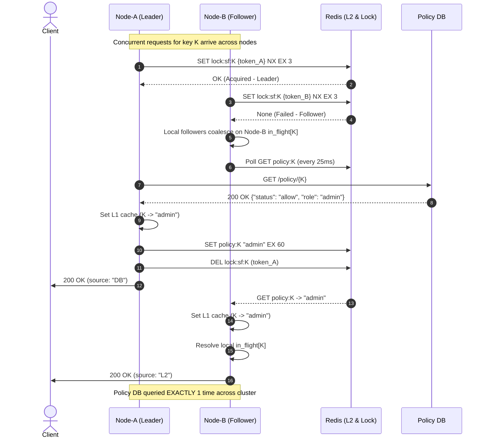

# Cluster-Wide Single-Flight Coordination Design

## 1. Overview & Problem Statement

In **PoP-Sync**, each gateway node maintains an in-memory `in_flight` map (`dict[str, asyncio.Future]`) that coalesces concurrent requests for the same policy key *within that single process*.
When concurrent requests arrive at a single node for a key not in L1/L2, the first request becomes the leader and queries Policy DB, while the other requests await the leader's `Future`.

However, across a cluster of multiple gateway nodes (e.g., `Node-A`, `Node-B`, `Node-C`):
- Each gateway node's `in_flight` map is strictly process-local.
- When concurrent requests for the same policy key arrive simultaneously at different gateway nodes (e.g. via round-robin DNS or reverse proxy load balancing), each node experiences a local cache miss and initiates its own query to Policy DB.
- At cluster scale with $N$ nodes, Policy DB is queried $N$ times instead of 1 time.

This document presents an additive, non-breaking design for **cluster-wide single-flight coordination** using Redis, ensuring that across the entire cluster, **exactly one node** queries Policy DB for a given cache key during a concurrent burst, while all other nodes wait and reuse the result from L2 cache.

---

## 2. Architecture & Coordination Mechanism

### 2.1 Coordination Primitives

1. **Distributed Key-Level Lock (Leader Election)**:
   - Redis Key: `lock:sf:{comp_key}`
   - Value: Fencing token `{node_name}:{uuid4()}`
   - TTL: `CLUSTER_SF_LOCK_TTL_SEC` (default: 3.0s)
   - Command: `SET lock:sf:{comp_key} {token} NX EX {ttl}`
   - If acquired (`True`), the node is elected as the **Cluster Leader** for `comp_key`.
   - If not acquired (`False`), the node becomes a **Cluster Follower** for `comp_key`.

2. **Safe Lock Release (Fencing Token Check)**:
   - Releasing the lock uses an atomic Lua script:
     ```lua
     if redis.call("GET", KEYS[1]) == ARGV[1] then
         return redis.call("DEL", KEYS[1])
     else
         return 0
     end
     ```
   - This ensures a slow leader whose lock expired cannot inadvertently delete a lock acquired by a successor leader.

3. **Follower Polling with Backoff**:
   - Cluster Followers wait on the cluster leader by polling the existing L2 cache key `policy:{comp_key}`.
   - Poll interval: `CLUSTER_SF_POLL_INTERVAL_SEC` (default: 0.025s / 25ms).
   - Maximum wait timeout: `CLUSTER_SF_TIMEOUT_SEC` (default: 2.0s).
   - Once the cluster leader writes the policy to L2, followers retrieve it immediately, populate their local L1, and resolve their local `in_flight` futures.

4. **Preserved Synergy with Process-Local Single-Flight**:
   - Process-local coalescing remains active on each node.
   - If 50 concurrent requests arrive at `Node-B`, only the *first* request on `Node-B` enters the cluster coordination loop as a follower; the remaining 49 requests coalesce onto `Node-B`'s local `in_flight` future.
   - When `Node-B`'s follower task receives the result from L2, all 50 requests on `Node-B` resolve simultaneously.

---

## 3. Scenarios & Detailed Workflows

### 3.1 Happy Path Workflow



1. Requests arrive at `Node-A` and `Node-B` concurrently for cache key $K$.
2. Both miss L1 and L2. Each creates a local `Future` in its local `in_flight[K]`.
3. `Node-A` attempts `SET lock:sf:K ... NX EX 3` and succeeds $\rightarrow$ **Cluster Leader**.
4. `Node-B` attempts `SET lock:sf:K ... NX EX 3` and fails $\rightarrow$ **Cluster Follower**.
5. `Node-A` queries Policy DB, populates L1, populates L2 (`policy:K`), resolves local `fut_A`, and safely releases the lock.
6. `Node-B` polls L2, detects `policy:K`, populates its local L1, resolves local `fut_B`, and records `singleflight_coalesced += 1`.
7. Policy DB query count across the entire cluster is **1**.

---

### 3.2 Leader Node Crash Mid-Query

What happens if the cluster leader (`Node-A`) crashes or is partitioned after acquiring the lock?

```text
[Node-A crashes after acquiring lock:sf:K]
       │
       ├─ Lock TTL (CLUSTER_SF_LOCK_TTL_SEC = 3.0s) counts down in Redis
       │
       ├─ Node-B (Follower) polls L2 and checks lock existence:
       │     ├─ While lock exists and L2 empty: continues polling (sleep 25ms)
       │     └─ Once lock expires (or EXISTS == 0) before L2 populated:
       │           │
       │           ├─ Node-B attempts leader takeover:
       │           │  SET lock:sf:K {token_B} NX EX 3
       │           │
       │           ├─ [Takeover Succeeded]: Node-B promotes itself to Cluster Leader
       │           │  queries Policy DB, sets L1/L2, resolves in_flight
       │           │
       │           └─ [Takeover Failed or Timeout]: If CLUSTER_SF_TIMEOUT_SEC elapsed,
       │              Node-B safely falls back to direct DB query or circuit fallback
       │
       └─ Result: Followers NEVER hang indefinitely.
```

- **Lock TTL / Expiration**: The lock has a strict TTL (3.0s). A crashed leader cannot hold the lock forever.
- **Leader Takeover**: Follower nodes check `EXISTS lock:sf:{comp_key}`. If the lock has expired without L2 being populated, followers compete to acquire the lock. The winning follower promotes itself to leader and queries Policy DB.
- **Bounded Timeout**: If `CLUSTER_SF_TIMEOUT_SEC` (2.0s) elapses without L2 being populated or lock acquired, followers break out and fall back safely.
- **Fencing Protection**: If a crashed or paused leader revives and tries to delete the lock, its token check fails, preventing it from releasing a successor's lock.

---

### 3.3 Interaction with Circuit Breaker

The Circuit Breaker protects downstream Policy DB from cascading failures.
- **Leader Node**:
  - The leader node checks `cb.can_execute()` before querying Policy DB.
  - If `cb.state == "OPEN"`, `can_execute()` returns `False`. The leader does NOT query DB; it immediately returns `200 OK` (`status: "degraded_allow"`, `source: "Fallback_Degradation"`) and releases the lock.
  - If the leader queries Policy DB and receives 503 / timeout, it calls `cb.record_failure()`, increments circuit failures, and returns `Fallback_Degradation_PostFail`.
- **Follower Node**:
  - If the leader fails and degrades without populating L2, the follower detects lock expiration / empty L2.
  - Before the follower performs any fallback DB query, it evaluates its own `cb.can_execute()`.
  - If the follower's circuit breaker is OPEN, it degrades gracefully without touching the DB.
  - Follower nodes never bypass circuit breaker state.

---

### 3.4 Interaction with Fail-Closed Nonce Logic

- Nonce consumption (`consume_nonce(x_nonce)`) executes in **Step 3** of the pipeline, strictly **before** cache lookup (Step 5) and single-flight execution (Step 6).
- **Redis Outage**:
  - If Redis is down, `consume_nonce()` raises an exception and `/auth` immediately returns `503 Service Unavailable - Nonce Check Failed` (`redis_outage_blocked + 1`).
  - Requests never proceed to cache lookup or single-flight coordination.
- **Redis Degradation During Single-Flight**:
  - If Redis fails specifically during cluster lock acquisition or L2 polling, all Redis calls are caught in `try...except Exception`.
  - The node logs a warning and gracefully falls back to process-local single-flight (existing behavior).

---

## 4. Invariant Balance & Metrics

The system enforces two core mathematical invariants:
1. **Request Classification Invariant**:
   $$\text{requests} = \text{rate\_limited} + \text{nonce\_replays} + \text{pop\_rejected} + \text{l1\_hits} + \text{l2\_hits} + \text{db\_fallbacks} + \text{redis\_outage\_blocked}$$
2. **Strong DB Fallback Invariant**:
   $$\text{db\_fallbacks} = \text{db\_queries\_executed} + \text{singleflight\_coalesced} + \text{l1\_double\_check\_hits} + (\text{circuit\_blocked} - \text{pubkey\_circuit\_blocked})$$

### Invariant Balance Across Leader and Follower Nodes:
- On **Leader Node** (e.g. `Node-A`):
  - Request enters DB fallback: `db_fallbacks += 1`.
  - Executes DB query: `db_queries_executed += 1`, `singleflight_leader_queries += 1`.
  - Strong Invariant: `1 == 1 + 0 + 0 + 0` (PASS).
- On **Follower Node** (e.g. `Node-B`):
  - Request enters DB fallback: `db_fallbacks += 1`.
  - Coalesces with cluster leader via L2: `singleflight_coalesced += 1`, `db_queries_executed += 0`.
  - Strong Invariant: `1 == 0 + 1 + 0 + 0` (PASS).

Across $N$ concurrent requests over $M$ nodes for the same key:
$$\sum \text{db\_queries\_executed} = 1$$
$$\sum \text{singleflight\_coalesced} = N - 1$$
$$\sum \text{db\_fallbacks} = N$$
Both invariants hold unconditionally on every node.
